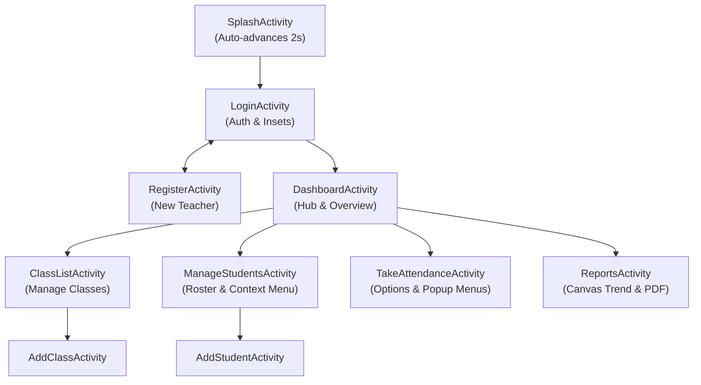
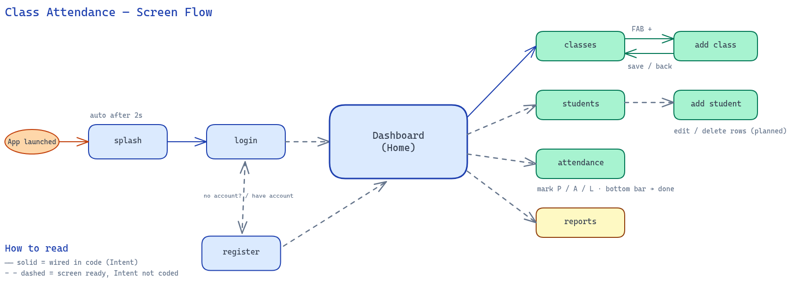
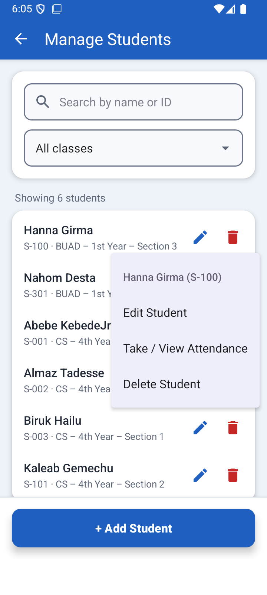
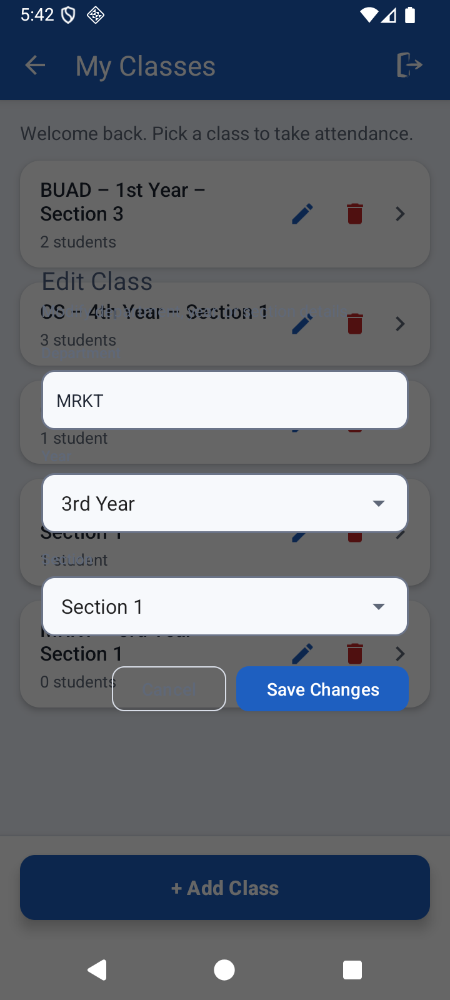
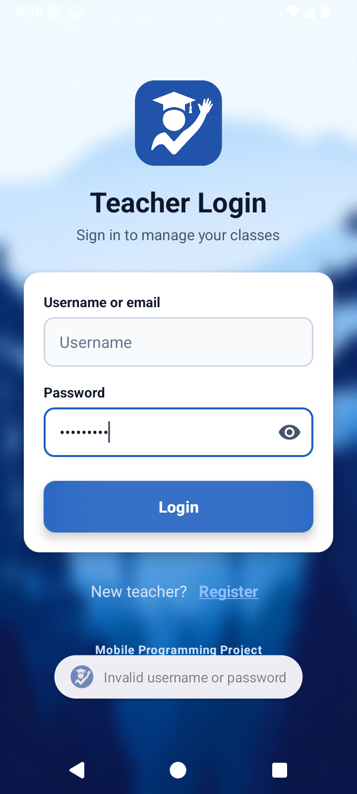

# Classroom Attendance Management
## Course Project Technical Report & Presentation

**Course**: Mobile App Development  
**Core Technologies**: Android Native (**Java**), Declarative **XML**, and **SQLite Database**  
**Version**: `v1.0.0` | **Repository**: [kalcoder101/classroom-attendance-management](https://github.com/kalcoder101/classroom-attendance-management)

---

## 1. Executive Summary & Application Architecture

**Classroom Attendance Management** is an Android application designed for educators and instructors to streamline attendance recording, maintain academic rosters, inspect attendance trends, and generate official institutional multi-page PDF documents directly from mobile devices.

### Architecture Overview
The app employs an **MVC pattern backed by a dedicated Data Access Object (DAO) layer** interacting with a local SQLite database (`class_attendance.db`):
- `TeacherDao`: Manages instructor accounts, credential hashing, and authentication state.
- `ClassDao`: Oversees academic courses (Department, Year, Section) with cascading deletions.
- `StudentDao`: Handles student rosters, search indexing, and class enrollment mappings.
- `AttendanceDao`: Manages session timestamps and atomic student attendance states (Present, Absent, Late).





---

## 2. Android Menu & Dialog Architecture (Course Requirements)

The application strictly implements all **four required Android menu and dialog mechanisms**:
1. **Options Menu** (Toolbar / App Bar Overflow)
2. **Context Menu** (Floating contextual actions upon long-press)
3. **Popup Menu** (Anchored contextual dropdown button)
4. **Dialogs** (Custom Layout Dialogs and `AlertDialog.Builder`)

---

### Component 1: Options Menu

#### Where It Is Used
- **Activity**: `TakeAttendanceActivity`
- **Location**: Top App Bar 3-dot overflow menu (`MaterialToolbar` with `app:menu="@menu/menu_take_attendance"`).

#### What It Does
- **Bulk Attendance**: "Mark All Present" or "Mark All Absent" across the entire class in a single click.
- **Dynamic Sorting**: Toggles roster order alphabetically by **Student Name** or by **Student ID** using a checkable single-choice group.
- **Display Customization**: Checkbox toggle to show or hide student code chips.
- **Session Logout**: Clears active teacher credentials and returns to `LoginActivity`.

#### Visual Evidence


#### Code Walkthrough
**XML Declaration (`app/src/main/res/menu/menu_take_attendance.xml`):**
```xml
<menu xmlns:android="http://schemas.android.com/apk/res/android"
    xmlns:app="http://schemas.android.com/apk/res-auto">

    <item
        android:id="@+id/menu_mark_all_present"
        android:title="Mark All Present"
        app:showAsAction="never" />

    <item
        android:id="@+id/menu_clear_all"
        android:title="Mark All Absent"
        app:showAsAction="never" />

    <group
        android:id="@+id/group_sort"
        android:checkableBehavior="single">
        <item
            android:id="@+id/menu_sort_name"
            android:checked="true"
            android:title="Sort by Name"
            app:showAsAction="never" />
        <item
            android:id="@+id/menu_sort_id"
            android:title="Sort by ID"
            app:showAsAction="never" />
    </group>

    <item
        android:id="@+id/menu_show_id"
        android:checkable="true"
        android:checked="true"
        android:title="Show student ID"
        app:showAsAction="never" />

    <item
        android:id="@+id/menu_logout"
        android:title="@string/logout"
        app:showAsAction="never" />
</menu>
```

**Java Handler (`TakeAttendanceActivity.java`):**
```java
MaterialToolbar toolbar = findViewById(R.id.toolbar);
toolbar.setOnMenuItemClickListener(item -> {
    int id = item.getItemId();
    if (id == R.id.menu_logout) {
        Logout.go(this);
        return true;
    } else if (id == R.id.menu_mark_all_present) {
        markAllPresent();
        return true;
    } else if (id == R.id.menu_clear_all) {
        markAllStatus(AttendanceDao.STATUS_ABSENT);
        return true;
    } else if (id == R.id.menu_sort_name) {
        item.setChecked(true);
        sortByName = true;
        sortAndRenderStudents();
        return true;
    } else if (id == R.id.menu_sort_id) {
        item.setChecked(true);
        sortByName = false;
        sortAndRenderStudents();
        return true;
    } else if (id == R.id.menu_show_id) {
        showStudentId = !item.isChecked();
        item.setChecked(showStudentId);
        sortAndRenderStudents();
        return true;
    }
    return false;
});
```

---

### Component 2: Context Menu

#### Where It Is Used
- **Activity**: `ManageStudentsActivity`
- **Location**: Activated on **long-press** over any student row in the roster list.

#### What It Does
- Registers individual student views via `registerForContextMenu(row)`.
- Intercepts `onCreateContextMenu` to dynamically configure the floating header with the selected student's full name and student code.
- Offers three contextual options:
  1. **Edit Student**: Opens the custom edit dialog preloaded with the student's information.
  2. **Take / View Attendance**: Direct shortcut launching `TakeAttendanceActivity` pre-filtered for that student's enrolled class.
  3. **Delete Student**: Triggers safety confirmation dialog before removing the record.

#### Visual Evidence


#### Code Walkthrough
**XML Declaration (`app/src/main/res/menu/menu_student_context.xml`):**
```xml
<menu xmlns:android="http://schemas.android.com/apk/res/android">
    <item
        android:id="@+id/ctx_edit_student"
        android:title="Edit Student" />
    <item
        android:id="@+id/ctx_view_attendance"
        android:title="Take / View Attendance" />
    <item
        android:id="@+id/ctx_delete_student"
        android:title="Delete Student" />
</menu>
```

**Java Registration & Handling (`ManageStudentsActivity.java`):**
```java
// 1. Register student row view
row.setTag(student);
registerForContextMenu(row);

// 2. Inflate contextual menu dynamically
@Override
public void onCreateContextMenu(ContextMenu menu, View v, ContextMenu.ContextMenuInfo menuInfo) {
    super.onCreateContextMenu(menu, v, menuInfo);
    if (v.getTag() instanceof Student) {
        selectedStudentForContextMenu = (Student) v.getTag();
        menu.setHeaderTitle(selectedStudentForContextMenu.getFullName() 
                + " (" + selectedStudentForContextMenu.getStudentCode() + ")");
        getMenuInflater().inflate(R.menu.menu_student_context, menu);
    }
}

// 3. Handle context item selection
@Override
public boolean onContextItemSelected(MenuItem item) {
    if (selectedStudentForContextMenu == null) return super.onContextItemSelected(item);

    int id = item.getItemId();
    if (id == R.id.ctx_edit_student) {
        showEditDialog(selectedStudentForContextMenu);
        return true;
    } else if (id == R.id.ctx_view_attendance) {
        Intent intent = new Intent(this, TakeAttendanceActivity.class);
        intent.putExtra(LoginActivity.EXTRA_TEACHER_ID, teacherId);
        intent.putExtra(ClassListActivity.EXTRA_CLASS_ID, selectedStudentForContextMenu.getClassId());
        startActivity(intent);
        return true;
    } else if (id == R.id.ctx_delete_student) {
        confirmDeleteStudent(selectedStudentForContextMenu);
        return true;
    }
    return super.onContextItemSelected(item);
}
```

---

### Component 3: Popup Menu

#### Where It Is Used
- **Activity**: `TakeAttendanceActivity`
- **Location**: Each row item in the attendance list features an explicit 3-dot icon button (`btnStudentPopup`).

#### What It Does
- Anchors an `android.widget.PopupMenu` directly beneath the tapped button.
- Allows teachers to change individual student attendance marks (**Mark Present**, **Mark Absent**, **Mark Late**) without needing to touch small radio button targets.
- Features **Student Info**: Opens an `AlertDialog` detailing the student's name, ID, class, and active session mark.

#### Visual Evidence


#### Code Walkthrough
**XML Declaration (`app/src/main/res/menu/menu_student_popup.xml`):**
```xml
<menu xmlns:android="http://schemas.android.com/apk/res/android">
    <item android:id="@+id/action_mark_present" android:title="Mark Present" />
    <item android:id="@+id/action_mark_absent" android:title="Mark Absent" />
    <item android:id="@+id/action_mark_late" android:title="Mark Late" />
    <item android:id="@+id/action_student_details" android:title="Student Info" />
</menu>
```

**Java Implementation (`TakeAttendanceActivity.java`):**
```java
private void showStudentPopupMenu(View anchor, Student student,
                                  RadioButton rbPresent, RadioButton rbAbsent, RadioButton rbLate) {
    PopupMenu popup = new PopupMenu(this, anchor);
    popup.getMenuInflater().inflate(R.menu.menu_student_popup, popup.getMenu());
    popup.setOnMenuItemClickListener(item -> {
        int id = item.getItemId();
        if (id == R.id.action_mark_present) {
            rbPresent.setChecked(true);
            return true;
        } else if (id == R.id.action_mark_absent) {
            rbAbsent.setChecked(true);
            return true;
        } else if (id == R.id.action_mark_late) {
            rbLate.setChecked(true);
            return true;
        } else if (id == R.id.action_student_details) {
            new AlertDialog.Builder(this)
                    .setTitle("Student Info")
                    .setMessage("Name: " + student.getFullName() + "\n"
                            + "ID: " + student.getStudentCode() + "\n"
                            + "Class: " + classLabel + "\n"
                            + "Current Mark: " + statuses.get(student.getId()))
                    .setPositiveButton("OK", null)
                    .show();
            return true;
        }
        return false;
    });
    popup.show();
}
```

---

### Component 4: Dialogs

#### Where They Are Used
1. **Custom Edit Class Dialog**: `ClassListActivity` (`dialog_edit_class.xml`)
2. **Custom Edit Student Dialog**: `ManageStudentsActivity` (`dialog_edit_student.xml`)
3. **Cascade Warning & Confirmation Dialog**: `ClassListActivity` & `ManageStudentsActivity`
4. **Information Summary Dialog**: `TakeAttendanceActivity`

#### What They Do
- **Custom View Dialogs**: Dynamically inflates custom layouts allowing instructors to update department codes, year levels, and section dropdowns with real-time SQLite duplicate constraint checks.
- **Destructive Deletion Confirmation**: Alerts teachers to cascading consequences (e.g. deleting a class automatically removes all associated students and session records from SQLite).

#### Visual Evidence
| Custom Edit Class Dialog | Student Info Alert Dialog |
|---|---|
|  |  |

#### Code Walkthrough
**Custom Dialog with Custom View Inflation (`ClassListActivity.java`):**
```java
private void showEditClassDialog(SchoolClass schoolClass) {
    View dialogView = LayoutInflater.from(this).inflate(R.layout.dialog_edit_class, null);
    EditText etDepartment = dialogView.findViewById(R.id.etEditDepartment);
    Spinner spYear = dialogView.findViewById(R.id.spEditYear);
    Spinner spSection = dialogView.findViewById(R.id.spEditSection);

    etDepartment.setText(schoolClass.getDepartment());
    spYear.setSelection(Math.max(0, schoolClass.getYear() - 1));
    spSection.setSelection(Math.max(0, schoolClass.getSection() - 1));

    AlertDialog dialog = new AlertDialog.Builder(this)
            .setView(dialogView)
            .create();

    dialogView.findViewById(R.id.btnCancelEditClass).setOnClickListener(v -> dialog.dismiss());
    dialogView.findViewById(R.id.btnSaveEditClass).setOnClickListener(v -> {
        String department = etDepartment.getText().toString().trim().toUpperCase();
        int year = spYear.getSelectedItemPosition() + 1;
        int section = spSection.getSelectedItemPosition() + 1;

        if (classDao.existsExcept(teacherId, department, year, section, schoolClass.getId())) {
            etDepartment.setError("You already have this class");
            return;
        }

        if (classDao.update(schoolClass.getId(), department, year, section)) {
            loadClasses();
            dialog.dismiss();
        }
    });

    dialog.show();
}
```

---

## 3. UI/UX Refinements ("Unslop" Features)

### 1. Password Visibility Eye Toggle
Integrated interactive vector toggle icons (`ic_visibility.xml` and `ic_visibility_off.xml`) on both `LoginActivity` and `RegisterActivity`. Toggling dynamically swaps the `TransformationMethod` between `PasswordTransformationMethod` and `HideReturnsTransformationMethod` while preserving the exact cursor index.


### 2. Software Keyboard Insets Handling (`WindowInsetsCompat.Type.ime()`)
On edge-to-edge layouts, standard `adjustResize` can be eclipsed by virtual software keyboards. The app dynamically measures the software keyboard's height via `WindowInsetsCompat.Type.ime()` and adjusts bottom padding:
```java
ViewCompat.setOnApplyWindowInsetsListener(findViewById(R.id.main), (v, insets) -> {
    Insets bars = insets.getInsets(WindowInsetsCompat.Type.systemBars());
    Insets ime = insets.getInsets(WindowInsetsCompat.Type.ime());
    int bottomPadding = Math.max(bars.bottom, ime.bottom);
    v.setPadding(bars.left, bars.top, bars.right, bottomPadding);
    return insets;
});
```
This guarantees that input fields and action buttons always scroll smoothly above the keyboard.

### 3. Dynamic Dashboard
- Displays dynamic time-of-day greeting (`Good morning`, `Good afternoon`, `Good evening`).
- Live database counters across all quick actions.
- Interactive "Last Attendance Recorded" card displaying attendance rate badges, status pills, and direct drill-down navigation.


---

## 4. Institutional Multi-Page PDF Exporter

The app includes a native PDF generation engine (`PdfReportExporter.java`) using Android's native `android.graphics.pdf.PdfDocument`:
- **Standard A4 Layout**: Measures 595 x 842 points with pagination support.
- **Institutional Header**: Organization header with generated timestamp and class metadata.
- **Metric KPI Grid**: 4-card metric block summarizing attendance rate, total sessions, and aggregate student marks.
- **Session History & Roster Table**: Full tabular output with `<75%` low-attendance warning indicators (`⚠`).
- **Instructor Verification**: Clean signature and date sign-off block.
- **Secure File Sharing**: Integrates `androidx.core.content.FileProvider` (`${applicationId}.fileprovider`) to share reports directly to email, Drive, or print services.

---

## 5. Verification & Test Suite Results

- **Unit Tests**: Passed `./gradlew test` with **0 failures**.
- **Compilation**: Clean `./gradlew assembleDebug` build.
- **Real-Device / Emulator Testing**: Fully verified on Android 16 (`Flutter_Lite(AVD) - 16`).
- **GitHub Release Deliverable**: Published at [v1.0.0](https://github.com/kalcoder101/classroom-attendance-management/releases/tag/v1.0.0).
