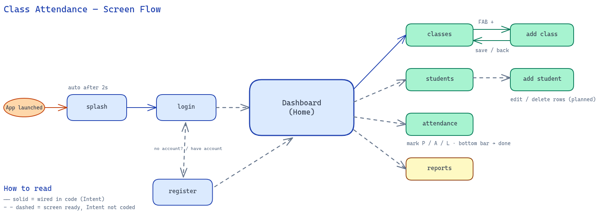

# Classroom Attendance Management

An Android mobile application for instructors and teachers to manage classes, maintain student rosters, record daily attendance sessions, and generate multi-page institutional PDF attendance reports.

> **Course**: Mobile App Development  
> **Technologies Used**: **Java**, **XML**, and **SQLite**

Built as a semester project for the **Mobile App Development** course using Native Android (**Java**), declarative **XML** UI layouts, and local **SQLite** database persistence with foreign key cascade constraints.

---

## Key Features

- **Teacher Authentication**: Register new teacher accounts and log in securely. Passwords support show/hide visibility toggles with soft-keyboard insets handling.
- **Dynamic Dashboard**:
  - Time-of-day contextual greeting (`Good morning,`, `Good afternoon,`, `Good evening,`).
  - Uppercase date chip with live counters for classes, enrolled students, and sessions.
  - Interactive "Last Attendance Recorded" card displaying date, attendance rate percentage badge, and Present/Absent/Late status pills with tap-to-review navigation.
- **Class Management**:
  - Create, view, edit, and delete academic classes (Department, Year, Section).
  - Deletion includes an explicit cascade warning confirming removal of enrolled students and historical attendance sessions.
- **Student Management**:
  - Real-time search across student names and student IDs.
  - Class filter dropdown.
  - Add, edit, and delete enrolled students.
- **Take Attendance**:
  - Material 3 Date Picker with past-dates validation and relative date labels.
  - Radio options per student: **Present (P)**, **Absent (A)**, **Late (L)**.
  - Live summary chips updated on the fly.
  - Bulk actions: "Mark All Present" button and "Mark All Absent" menu option.
- **Analytics & Multi-Page PDF Reports**:
  - Filter reports by specific class or view overall statistics across all classes.
  - Summary cards: Overall Attendance Rate, Total Sessions, and aggregated Present/Absent/Late counts.
  - Custom Canvas-based Attendance Rate Trend line & area chart.
  - **Native Multi-Page PDF Export**: Generates printable A4 reports containing institution headers, attendance KPI grid, recent sessions table, complete student roster with `<75%` low attendance warnings (`⚠`), and instructor signature block. Shared directly via Android `FileProvider`.

---

## Screen Flow & Activity Diagram

The diagram below maps the application architecture, navigational transitions (`Intent`), and screen flow across activities:



### Navigation Overview
1. **Entry**: `SplashActivity` auto-advances after 2 seconds to `LoginActivity`.
2. **Authentication**: Teachers can log in or transition to `RegisterActivity` to create an account, which routes directly to the main dashboard.
3. **Core Dashboard (Home)**: Acts as the central hub connecting to:
   - **Classes (`ClassListActivity`)**: View enrolled classes, tap `+` to open `AddClassActivity`, or tap edit/delete on cards.
   - **Students (`ManageStudentsActivity`)**: Filter by class, search by name or ID, launch `AddStudentActivity`, and manage roster.
   - **Attendance (`TakeAttendanceActivity`)**: Select calendar date, toggle Present/Absent/Late marks, bulk mark, or inspect individual student stats.
   - **Reports (`ReportsActivity`)**: View attendance KPIs, visual trend line charts, and export PDF documents.

---

## Android Menu & Dialog Architecture

This project strictly adheres to course requirements by implementing all four standard Android menu and dialog mechanisms:

| Type | Implementation | Location | Actions |
|---|---|---|---|
| **Dialog** | `AlertDialog` & Custom Views | `ManageStudentsActivity`, `ClassListActivity`, `TakeAttendanceActivity` | Custom edit dialogs (`dialog_edit_student.xml`, `dialog_edit_class.xml`), deletion confirmation dialogs, and student info dialogs. |
| **Options Menu** | `menu_take_attendance.xml` | `TakeAttendanceActivity` (App Bar 3-dot overflow) | Bulk "Mark All Present", "Mark All Absent", radio group "Sort by Name / ID", and checkbox "Show/Hide Student ID". |
| **Context Menu** | `menu_student_context.xml` | `ManageStudentsActivity` (Long-press student row) | Floating contextual menu titled with the student's name and ID: "Edit Student", "View Attendance", and "Delete Student". |
| **Popup Menu** | `android.widget.PopupMenu` | `TakeAttendanceActivity` (Row 3-dot button) | Anchored dropdown on each student row: "Mark Present", "Mark Absent", "Mark Late", and "Student Info". |

---

## Tech Stack & Architecture

- **Language**: Java 11
- **Target SDK**: Android 16 (API 37) | **Minimum SDK**: Android 7.0 (API 24)
- **Architecture**: MVC with Repository/DAO Pattern (`TeacherDao`, `ClassDao`, `StudentDao`, `AttendanceDao`)
- **Database**: SQLite (`class_attendance.db`) with Foreign Keys enabled and `ON DELETE CASCADE`
- **UI Components**: Material Components (`com.google.android.material`), AndroidX AppCompat
- **PDF Engine**: Native Android `android.graphics.pdf.PdfDocument` with `FileProvider`

---

## Installation & Setup

### Option 1: Direct APK Installation
Download the pre-compiled APK from the [Releases](https://github.com/kalcoder101/classroom-attendance-management/releases) section or install directly via ADB:
```bash
adb install -r ClassAttendance-v1.0.0.apk
```

### Option 2: Build from Source
1. Clone this repository:
   ```bash
   git clone https://github.com/kalcoder101/classroom-attendance-management.git
   cd classroom-attendance-management
   ```
2. Build the project using Gradle:
   ```bash
   ./gradlew assembleDebug
   ```
3. Run the unit test suite:
   ```bash
   ./gradlew test
   ```

---

## First-Time Setup & Account Creation

On first launch, teachers can create an account directly through the app:
1. Tap the **Register** link on the Teacher Login screen.
2. Enter your Full Name, Username, and Password.
3. Log in to start creating classes and taking attendance.
